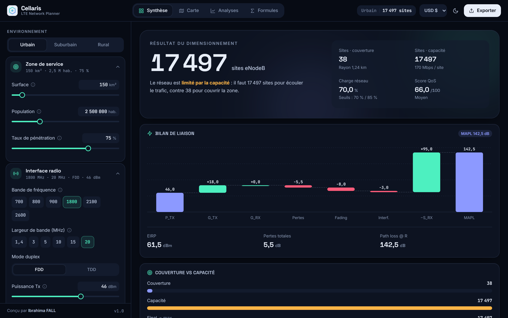
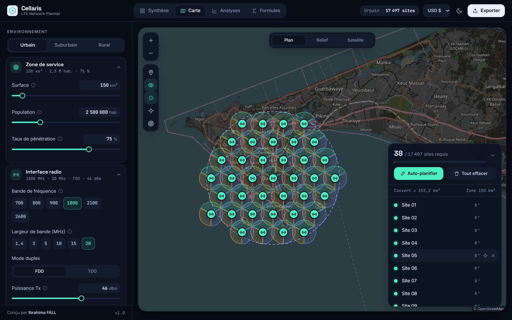
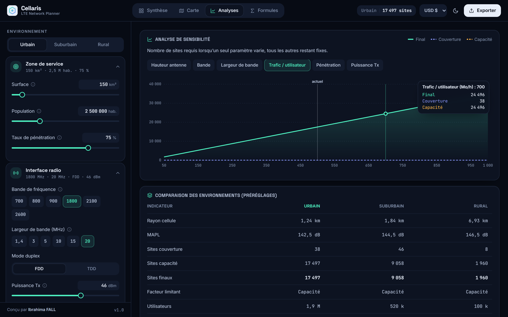
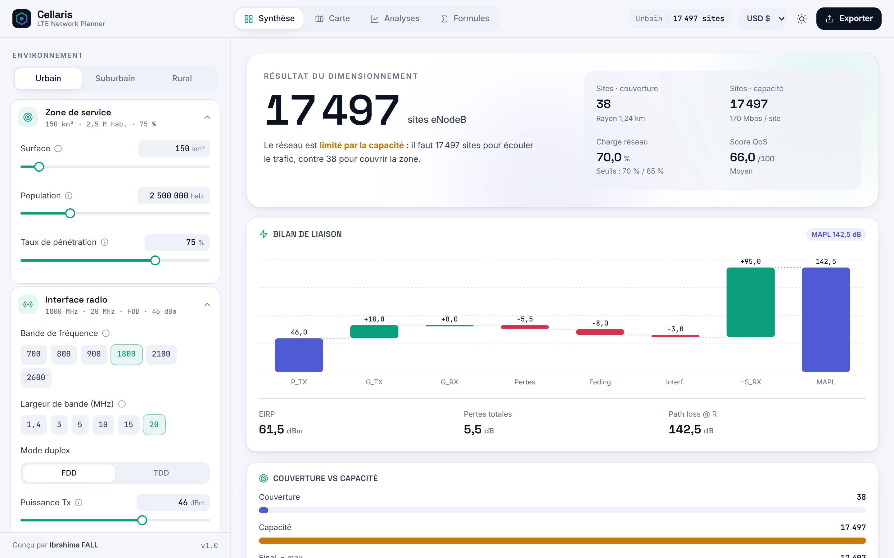
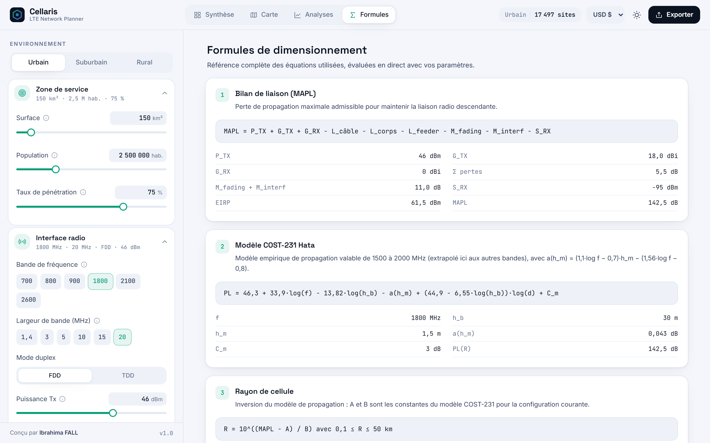
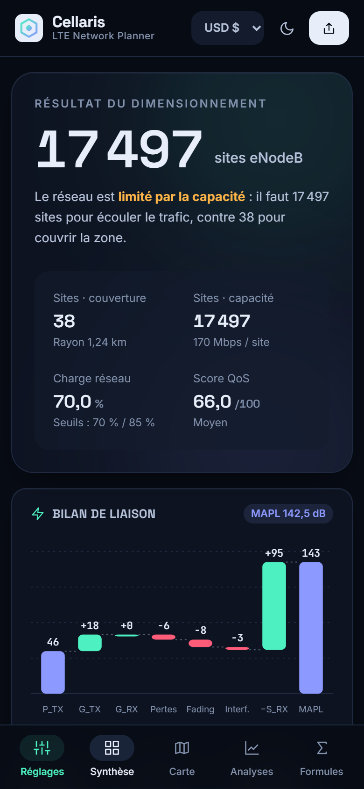
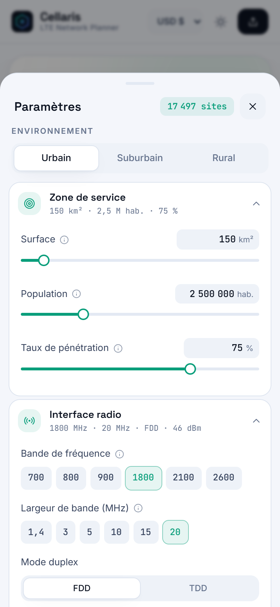

# Cellaris — LTE Network Planner

Outil de planification et de dimensionnement de réseaux LTE, conçu par **Ibrahima FALL**.

**▶ Démo en ligne : [cellaris.vercel.app](https://cellaris.vercel.app/)**



## Aperçu

| Carte & auto‑planification | Analyse de sensibilité |
| --- | --- |
|  |  |
| **Thème clair** | **Formules évaluées en direct** |
|  |  |

<p align="center">
  
  &nbsp;&nbsp;
  
</p>

## Fonctionnalités
- **Bilan de liaison** (EIRP, MAPL) en cascade interactive
- **Propagation COST‑231 Hata** → rayon de cellule
- **Dimensionnement** couverture vs capacité, facteur limitant, charge réseau
- **Coûts sur 5 ans** (CAPEX/OPEX) en USD, EUR ou FCFA
- **KPIs** : score QoS, efficacités, radar
- **Carte** : placement de sites eNodeB, secteurs orientables (azimut), **auto‑planification hexagonale**, fonds Plan / Relief / Satellite
- **Analyses** : sensibilité (sites vs hauteur, bande, trafic…) et comparaison des environnements
- **Formules** évaluées en direct
- **Exports** : rapport PDF, projet JSON (import/export), lien de partage
- Thème clair/sombre, mobile‑first, sauvegarde automatique, raccourcis `1`–`4`, annulation des actions

## Démarrer
```bash
npm install
npm run dev      # http://localhost:5173
npm test         # tests du moteur de calcul
npm run build    # build de production (dist/)
```

Déploiement Vercel : importer le dossier, preset **Vite** (build `npm run build`, sortie `dist`).

## Structure
- `src/engine/` — moteur de calcul pur (testé, reproduit à l'identique l'ancienne version)
- `src/store/` — état global (Zustand, persisté)
- `src/components/` — interface (React 19 + Tailwind CSS 4, graphiques SVG maison)
- `src/lib/report.ts` — rapport PDF (jsPDF, chargé à la demande)

© Ibrahima FALL
